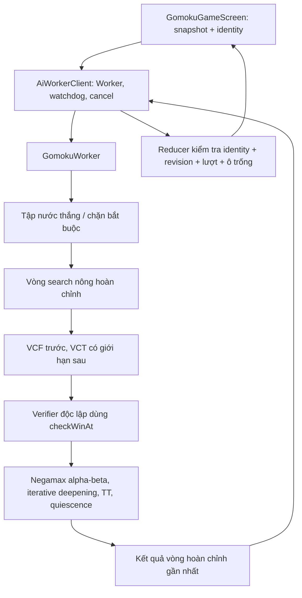

# Cờ Caro: engine AI mới

Bản triển khai thay engine từ QL2 `2a6f4a3`. AI production chạy offline trong Web Worker; bản cũ chỉ nằm trong harness so sánh. Chưa xác nhận sức cờ cao thủ, chưa có người chơi giỏi tham gia và chưa đối đầu engine chuyên dụng bên ngoài.

## Phạm vi và kiến trúc



| Hạng mục | Trạng thái thực tế |
| --- | --- |
| P0 luật/threat | Hoàn tất core ≥5, overline, sparse/infinite; W cập nhật theo 20 cửa sổ bị ảnh hưởng; oracle độc lập thử nước bằng luật game; ba được phân loại bằng tiếp diễn thật và cost squares |
| P0 ưu tiên chiến thuật | Thắng ngay trước chặn; một điểm thắng địch trả chặn ngay; nhiều điểm thắng địch có loss witness; ba mở đưa vào search, không tự động trả nước phòng thủ |
| P0 VCF/VCT | Có AND/OR solver, chứng chỉ chiến lược, replay mọi phòng thủ liên quan và counter-kill; verifier độc lập. VCF đến 25 ply; VCT tối đa hai bước tấn công chưa tạo đe dọa thắng ngay, giữa các chuỗi VCF. Không đầy đủ cho mọi VCT/Gomoku |
| P0 Worker | Module Worker thật do Vite bundle; search/threat/eval/cache chạy ngoài luồng UI; hủy terminate rồi tạo lại; Worker được tái dùng sau kết quả bình thường |
| P1 search/cache | Negamax alpha-beta, iterative deepening, root move ordering, TT EXACT/LOWER/UPPER, mate normalization, quiescence và make/unmake; hash + eval + W cập nhật tăng dần; beam chỉ cắt nước yên tĩnh; điểm search có chọn lọc không phải chứng minh |
| P1 runtime/độ khó/đo lường | Request hữu hạn, watchdog độc lập, fallback từ progress hợp lệ, retry tối đa hai lần mỗi lượt, lỗi không ghi kết quả; ba profile bất biến; test, fixture và đối đầu tái lập đã chạy. Nghiệm thu cao thủ còn thiếu dữ liệu |

`BoardCore` giữ hai hash 32-bit cập nhật bằng XOR trên toàn chuỗi tọa độ, kèm chữ ký đầy đủ sắp xếp để xác nhận va chạm cache. Tập cửa sổ chỉ sống khi chứa quân; unmake xóa cửa sổ rỗng. TT có hạn mức số entry và tổng ký tự chữ ký (`entries × 128`), FIFO eviction. Cây solver giới hạn bằng deadline, node, ply, hai quiet threat steps và cache tối đa 1.000 chứng chỉ; không dùng cache `unknown` làm chứng minh.

`ThreatAnalyzer` canonical hóa theo hướng và tập quân, không nhân bản cùng một threat vì các cửa sổ chồng lấn. Hai threat chia sẻ một cost square không được coi là fork độc lập. Heuristic xếp nước có bộ scan nhanh riêng, không gán nhãn thắng/thua từ điểm số. Evaluator của vị trí chưa giải vẫn đơn giản; đây là hạn chế sức cờ trung cuộc.

## Ngữ nghĩa chứng minh

- Thắng tức thì được luật chuẩn xác nhận. Nếu bên tới lượt không có nước thắng và đối phương có ít nhất hai ô thắng khác nhau, một quân không thể chiếm cả hai: `proven_loss` chỉ dùng cho trường hợp này, có `lossWitness` chứa tập ô thắng địch.
- Trong VCF, sau nước tấn công phải kiểm tra đối phương có thắng trước hay không. Hai ô thắng thật chứng minh fork; một ô thắng thật buộc đối phương chiếm đúng ô đó. Mọi nước khác thua ngay. Chứng chỉ lưu gain, forced reply và chứng chỉ tiếp theo.
- Trong VCT, một nước ba phải có chiến lược VCF mặc định nếu đối phương bỏ qua. Sinh mọi ô phòng thủ trên các đường dài năm qua quân hiện có hoặc các gain/reply/winning squares trong chứng chỉ VCF đó. Mỗi ô được replay; phòng thủ phá chiến lược mặc định cần một nhánh chứng minh thay thế.
- Các ô còn lại trên bàn vô hạn được phủ bằng một lớp tương đương: một quân nằm ngoài khoảng ±4 theo cả bốn hướng từ mọi quân của chiến lược mặc định không thể chiếm một gain/reply, phá chuỗi năm hay tham gia chuỗi thắng phản công nào trong VCF đó. Vì những lượt sau của VCF là bắt buộc, không có thêm lượt yên tĩnh cho đối phương xây phản công. Verifier tự dựng vùng này và tự thử các nước bằng `checkWinAt`, không gọi scanner hay move ordering của solver.
- Đây là chứng minh bảo thủ cho một lớp VCT hữu hạn, không phải bộ giải hoàn chỉnh của bàn vô hạn. Cắt thời gian/node/độ sâu, không tìm được lời giải hoặc không xác minh xong đều là `unknown`. Search tổng quát có beam và điểm mate dạng số vẫn giữ `proofStatus: unknown` nếu không có chứng chỉ đã kiểm tra.

## Cấu hình cuối

| | Dễ | Trung bình | Khó |
| --- | ---: | ---: | ---: |
| Thời gian tối đa mỗi nước | 200 ms | 800 ms | 2.800 ms |
| Node tổng | 1.200 | 12.000 | 60.000 |
| Độ sâu cơ bản tối đa | 2 | 4 | 10 |
| Beam yên tĩnh | 6 | 10 | 16 |
| Quiescence | 0 | 2 | 4 |
| TT tối đa | 2.000 | 12.000 | 40.000 |
| Phần ngân sách solver | 0 | 20% | 40% |
| Node solver | 0 | 2.000 | 10.000 |
| Ply solver | 0 | 9 | 25 |
| VCT | Không | Không | Có, tối đa hai quiet threat steps |
| Độ đa dạng trong tập điểm gần nhau | 20% | 4% | 0% |

Mọi mức lấy thắng/chặn một lượt ngay, không đợi hết budget. Vòng root nông phải hoàn tất trước solver để thiết bị/ngân sách nhỏ có nước tốt hơn dự phòng vị trí lân cận. Timeout giữ nguyên nước/điểm của vòng hoàn chỉnh trước; PRNG lấy seed của trận và revision. Watchdog ở UI = thời gian yêu cầu (không vượt profile) + 1.000 ms, terminate nếu Worker không trả. Không tự tăng mọi lượt lên 8 giây, không thêm public difficulty.

Benchmark mặc định đạt tối đa depth 2/4/5 ở Dễ/Trung bình/Khó; đây là số đã đạt, không cam kết depth 10. Cấu hình ưu tiên thời gian phản hồi hữu hạn; kết quả thử 120 ms cho thấy không nên thu ngân sách Khó xuống mức này và kỳ vọng giữ sức cờ. Chưa có điều chỉnh tự động theo thiết bị hay xác nhận pin/nhiệt trên máy yếu.

## Kiểm chứng

- `npm run test:gomoku`: **125 pass, 0 fail**. Gồm 60 bộ sinh ngẫu nhiên đối chiếu oracle và các phép xoay/phản chiếu/tịnh tiến/đổi X–O, ≥5/6/9 theo bốn hướng và cả hai mark, make/unmake/hash/W/eval/TT, forced move xa cụm đông, VCF, VCT nhiều đáp trả, counter-kill, certificate giả, deadline/node/cancel, request cũ/lặp/sai schema, crash/messageerror, watchdog, retry, reducer và entry Worker được bundle rồi chạy trong Node worker thread.
- VCF mẫu tìm được PV 11 ply, vượt search tổng quát; độc lập kiểm tra lại bằng luật. VCT hai ba mở tìm được nước giữa và chứng chỉ có các nhánh phòng thủ thay thế; xóa nhánh bắt buộc khiến verifier từ chối.
- `npm run lint` và `npm run build` đã chạy thành công. Build tạo chunk Worker riêng 16,64 kB; bundle app vẫn có cảnh báo >500 kB vốn có.
- Smoke trên Chromium của Codex, qua trang `scripts/gomoku/browser.html`: thắng/chặn đúng; search 2.800,3 ms, depth 4, 5.857 node; heartbeat UI chạy 174 lần trong lượt search, khoảng cách lớn nhất 30,8 ms. Ba lần cancel trả trong 0–0,1 ms; dispose dừng và settle. Đây là test tập trung Worker, không phải QA toàn game hay thiết bị yếu.
- Stress sparse 64/512/2.048 quân rải xa, ngân sách 120 ms: search trả timeout hợp lệ trong khoảng 120–121 ms; bản 512/2.048 dùng fallback trước search hoàn chỉnh. Heap lấy mẫu process khoảng 12,5/19,7/33 MiB. Kết quả không chứng minh sức cờ trên bàn lớn hoặc peak memory tuyệt đối.

Các test gameplay không liên quan không được chạy cục bộ. Reward adapter, daily reward, XP/mastery/medal, save schema, random starter 50:50, chọn X/O, pan/zoom, nhập liệu, nét vẽ, âm thanh và hiệu ứng kết thúc không đổi. UI chỉ thay gọi Worker và thêm thông báo lỗi/nút thử lại; đầu hàng bị vô hiệu trong lỗi để không ghi nhận kết quả vì lỗi hệ thống. Lỗi chỉ giữ bàn hoặc cho thoát, không phát thưởng.

## Benchmark và giới hạn kết luận

Dữ liệu JSON đầy đủ: [fixture](benchmarks/gomoku-fixtures.json), [profile mặc định](benchmarks/gomoku-profile-time.json), [cùng ngân sách yêu cầu 120 ms](benchmarks/gomoku-equal-time.json), [bàn sparse](benchmarks/gomoku-sparse-stress.json). Máy: Intel Core i5-10400, Windows, Node 24.19.0. Có tác vụ phát triển chạy đồng thời nên thời gian là đo thực nghiệm, không phải đo phòng lab độc lập.

Bộ fixture do người triển khai viết trước khi chạy benchmark, có `ruleId`, side, tọa độ, tập nước chấp nhận/chứng chỉ và nguồn kiểm tra. Tập phát triển 5 thế, holdout 6 thế tách riêng. Đây là hồi quy chiến thuật nhỏ được kiểm bằng oracle/certificate độc lập, **không phải bộ đề cao thủ đã được đánh giá bên ngoài**. Không điều chỉnh trọng số theo holdout. Các nước khác tập đáp án chưa được giải không tự động là sai.

| Engine | Phát triển: nước chấp nhận hoặc chứng chỉ hợp lệ | Holdout cùng tiêu chí |
| --- | ---: | ---: |
| Cũ (Khó) | 3/5 | 4/6 |
| Dễ | 4/5 | 5/6 |
| Trung bình | 5/5 | 6/6 |
| Khó | 5/5 | 6/6 |

Không thể lấy 6/6 ở sáu thế đơn giản để kết luận cao thủ. Một số nước khác của engine cũ có thể đúng nhưng chưa có chứng chỉ; tỷ lệ trên là số đã xác nhận, không phải tỷ lệ mọi nước còn lại đều sai.

Đối đầu dùng hai khai cuộc bốn quân, đổi phân công engine cho X/O trong mỗi cặp, đổi mark bên tới lượt ở khai cuộc thứ hai, seed cố định. Các khai cuộc được ghép cặp để giảm thiên lệch, chưa được engine tham chiếu chứng minh cân bằng. Mỗi cặp engine có bốn ván; dừng sau 60 nước mới chỉ là giới hạn harness, không thêm luật hòa vào game.

| Cấu hình | Cặp | Bên thứ nhất thắng | Thua | Chưa kết thúc |
| --- | --- | ---: | ---: | ---: |
| Profile mặc định | Khó – cũ Khó | 3 | 0 | 1 |
| Profile mặc định | Khó – Trung bình | 2 | 2 | 0 |
| Profile mặc định | Trung bình – Dễ | 4 | 0 | 0 |
| Cùng yêu cầu 120 ms | Khó – cũ Khó | 1 | 3 | 0 |
| Cùng yêu cầu 120 ms | Khó – Trung bình | 1 | 3 | 0 |
| Cùng yêu cầu 120 ms | Trung bình – Dễ | 2 | 2 | 0 |

Mẫu rất nhỏ; các ván theo cặp có tương quan. Để minh họa bất định, Wilson 95% cho tỷ lệ thắng **trước giới hạn nước**, giả sử tạm độc lập: 3/4 ≈ 30–95%, 2/4 ≈ 15–85%, 4/4 ≈ 51–100%, 1/4 ≈ 5–70%. Đây không phải khoảng tin cậy Elo/sức cờ và không biến ván chưa kết thúc thành hòa.

Ở profile mặc định, mean time/move: cũ 67 ms, Dễ 5,5 ms, Trung bình 498 ms, Khó 1.861 ms; p95 của Trung bình/Khó khoảng 800/2.800 ms. Khó đi qua 658.604 node và có 26 lượt với thắng đã chứng minh; Trung bình 233.404 node, 16 lượt tương ứng. Timeout search lần lượt 74 và 67, đều trả kết quả hợp lệ đã có; không phải lỗi watchdog. Heap lấy mẫu toàn process đạt khoảng 118 MiB sau cả giải, không phải peak riêng engine. Telemetry của engine cũ không có node/depth/proof; số 0 trong JSON các cột đó biểu thị không được instrument, không có nghĩa engine không tính toán. `depthZeroUnknownMoves` có cả nước chặn bắt buộc trả sớm, không phải số fallback Worker.

Kết quả cho thấy bản mới cải thiện chiến thuật được kiểm chứng và thắng baseline cũ trong mẫu ngân sách mặc định, nhưng chưa xác nhận Khó vượt Trung bình ổn định. Cần bộ trung cuộc/phòng thủ cao thủ lớn hơn, đối thủ tham chiếu đúng luật, nhiều opening/seed và kiểm tra với người chơi giỏi thật trước khi cam kết sức cờ. Không có Elo được gán, không có tuyên bố bất bại.

## Chạy lại

```powershell
npm install
npm run test:gomoku
npm run lint
npm run build
npm run bench:gomoku -- --mode=fixtures
npm run bench:gomoku -- --mode=tournament --pairs=2 --plies=60 --out=docs/benchmarks/gomoku-profile-time.json
npm run bench:gomoku -- --mode=tournament --time=120 --pairs=2 --plies=60 --out=docs/benchmarks/gomoku-equal-time.json
npx tsx scripts/gomoku/stress.ts
npx vite --host 127.0.0.1 --port 5174
# Mở http://127.0.0.1:5174/scripts/gomoku/browser.html rồi bấm Chạy kiểm tra.
```

Workflow `Gomoku AI Validation` chạy test nhanh, typecheck và build trên PR có thay đổi Gomoku, không chạy giải đấu. Benchmark nặng tách khỏi build/CI mặc định. Kết quả thời gian/node phụ thuộc tải máy; seed cố định không làm deadline thời gian trở thành deterministic. Test correctness sử dụng oracle và giới hạn node khi phù hợp.

## File thay đổi và license

- `src/features/training/gomoku-v13/ai/`: BoardCore, ThreatAnalyzer, TacticalSolver, ProofVerifier, PositionEvaluator, CandidateGenerator, SearchBudget, TranspositionTable, DifficultyProfiles, SearchEngine, aiTypes, WorkerProtocol, GomokuWorker, AiWorkerClient. Xóa PatternEvaluator cũ khỏi production.
- `domain/GomokuRules.ts`: interface luật dùng chung cho board mutable/immutable; kiểm tra quân tại điểm và safe coordinates. `domain/gomokuTypes.ts`, `domain/MatchReducer.ts`: identity, revision, error/retry và commit gate.
- `ui/GomokuGameScreen.tsx`: snapshot Worker, cleanup, xử lý lỗi/thử lại. `package.json`: lệnh test/benchmark.
- `scripts/gomoku/`: baseline cũ chỉ trong test, fixtures, test core/runtime, benchmark, stress và smoke browser. `docs/benchmarks/` và tài liệu này lưu bằng chứng.
- `.github/workflows/gomoku-validation.yml`: kiểm tra Gomoku riêng, lọc đường dẫn; không sửa workflow Chiến Tuyến hiện có.

Không thêm package, WASM, binary, model weights, API hay engine GPL. Core TypeScript tự triển khai. Cách tạo Worker theo [Vite](https://vite.dev/guide/features.html#web-workers), hủy cưỡng bức theo [Worker.terminate](https://developer.mozilla.org/en-US/docs/Web/API/Worker/terminate). Bài Allis được tham chiếu trong yêu cầu không được tải thành công (403); không sao chép code từ tài liệu đó hay Rapfi.
