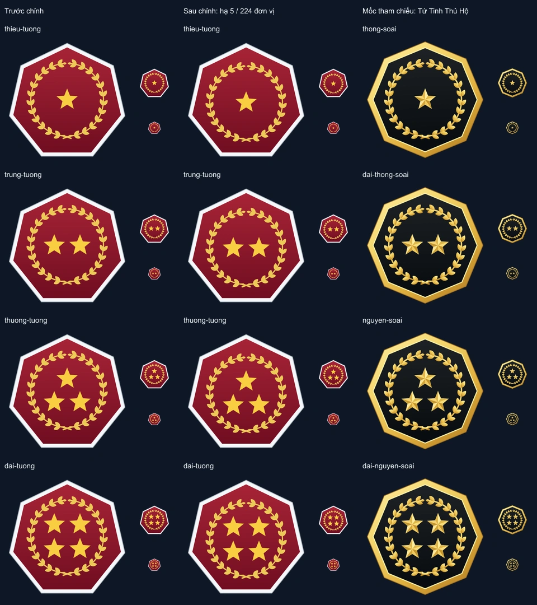

# Bộ huy hiệu PNG và hình học đa giác

Bộ asset gồm **24 PNG RGBA 896×896**, xuất trực tiếp từ SVG vector tự dựng. Renderer không đọc ảnh tham chiếu hay PNG cũ, không crop, trace pixel, upscale hoặc nhúng bitmap. Mỗi huy hiệu là một file riêng, nền trong suốt, không chứa chữ tên quân hàm.


## Cân bằng thị giác cấp Tướng

So với `b26a6fb`, chỉ bốn huy hiệu **Thiếu Tướng, Trung Tướng, Thượng Tướng, Đại Tướng** thay đổi. `GENERAL_OPTICAL_OFFSET_Y = 5` dịch cả vòng nguyệt quế và cụm sao từ tâm (112,112) xuống (112,117) trên canvas 224px, tương đương 20px trong PNG 896px và khoảng 1,12px khi hiển thị 50px. Một group dịch chuyển chung dùng cho cả `badge_general_1` đến `badge_general_4`; chỉ số sao khác nhau.

Đã đối chiếu cả bốn ảnh trước/sau với Tứ Tinh Thủ Hộ cùng số sao ở 224/56/24px. Mức hạ nhẹ giúp giảm cảm giác vòng bị nhấc lên trên và giữ bố cục gần cảm giác centered của nhóm tham chiếu, không làm nặng phần đáy. Vòng vẫn tròn bán kính 65, sao nằm giữa vòng; không scale hoặc chỉnh riêng lá, cành, sao hay gốc cành.

Audit xác nhận khung 7 cạnh và mọi lớp viền giữ nguyên, chỉ có phép `translate(0 5)` bao quanh artwork cũ. Nền đỏ, viền sáng, vàng nguyệt quế, sao flat 1/2/3/4 không đổi. Khoảng hở nhỏ nhất từ nội dung đến viền trong tăng từ 11,68 lên **16,18 đơn vị logic**. Cả 24 PNG giữ nguyên alpha; 20 huy hiệu ngoài nhóm Tướng giữ nguyên từng byte. Registry chỉ đổi bốn hash URL, không đổi ID, tên file, padding hoặc outer ratio. PNG cuối xuất sạch từ SVG, không lấy pixel từ ảnh tham chiếu.



## Rà soát số cạnh ngày 08/09/2026

Catalog đã khai báo đúng hình, nhưng renderer cũ dựng **Tướng thành 8 cạnh** và **Tổng Tư Lệnh thành 10 cạnh**. Tọa độ Úy, Tá và Tứ Tinh viết tay cũng chưa bảo đảm các cạnh bằng nhau. Đã thay bằng một hàm `regularPolygon(sides)` và xuất lại đúng 17 SVG/PNG so với baseline `2eba35b`:

| Nhóm | Huy hiệu | Số cạnh đều | Chiều rộng alpha / 896 |
| --- | --- | --- | --- |
| Úy | Thiếu / Trung / Thượng / Đại Úy | 5 | 832 |
| Tá | Thiếu / Trung / Thượng / Đại Tá | 6 | 720 |
| Tướng | Thiếu / Trung / Thượng / Đại Tướng | **7, sửa từ 8** | 832 |
| Tứ Tinh Thủ Hộ | Thống Soái / Đại Thống Soái / Nguyên Soái / Đại Nguyên Soái | 8 | 832 |
| Tổng Tư Lệnh | Tổng Tư Lệnh | **9, sửa từ 10** | 832 |

Các đỉnh cách nhau `2π/n` trên cùng đường tròn; hình chỉ được co bằng **một hệ số** cho cả hai trục. Bounding box phần khung được đặt giữa canvas 224×224, chừa tối thiểu 8 đơn vị mỗi bên. Với đa giác lẻ, tâm đường tròn ngoại tiếp khác tâm bounding box: mọi lớp viền và nền đều thu quanh **tâm hình học thực** đó, giữ nguyên góc, số cạnh và tính đồng tâm. Tọa độ khung SVG giữ sáu chữ số thập phân; audit cho phép sai số làm tròn dưới 0,000003 đơn vị logic.

## Chi tiết thiết kế được bảo toàn

Ở lượt sửa đa giác trên `b26a6fb`, audit so sánh toàn bộ markup phía sau các lớp khung với baseline `2eba35b`: mọi ngôi sao, vòng tròn, lá, thân cành và phép đặt vị trí đều giữ nguyên. Lượt cân bằng thị giác tiếp theo chỉ dịch nhóm nội dung cấp Tướng như mô tả ở trên. Bảy huy hiệu Học Viên/Binh Sĩ/Hạ Sĩ Quan vẫn giữ nguyên PNG từng byte và nội dung SVG.

- Úy: sao flat 1/2/3/4, bán kính 20; vòng kín tâm (112,120), bán kính 59, nét 3,8. Offset thị giác 8 đơn vị vẫn giữ cho vòng, sao và cặp mini laurel. Gốc chung tại (112,193), năm cặp lá và một lá tận cùng mỗi bên, cung 55 độ; cùng một base cho cả bốn cấp.
- Tá: sao flat bán kính 20; vòng trắng tâm (112,112), bán kính 57. Sáu cặp lá mỗi bên, thân 2,1 và cuống giao 2,4 đơn vị.
- Tướng: nền đỏ, viền sáng, sao flat bán kính 20; vòng nguyệt quế vàng tròn bán kính 65, 12 cặp lá mỗi bên. Nội dung hiện có tâm (112,117); khoảng cách nhỏ nhất từ pixel nội dung đến mép nền trong khung 7 cạnh là **16,18 đơn vị logic**, đủ thoáng mà không phải co sao hoặc bóp vòng.
- Tứ Tinh Thủ Hộ: nền đen, viền vàng, vòng nguyệt quế tròn bán kính 65; thân 2,5, cuống giao 2,9, lá vàng có gân; sao ceremonial bán kính 20.
- Tổng Tư Lệnh: năm nhánh quay đều từng 72 độ; sao ceremonial trung tâm bán kính 45, lớn nhất bộ; khung **chín cạnh** vàng.

Kiểm tra raster nội dung riêng xác nhận không chạm viền trong ở cả 17 huy hiệu. Khoảng cách tối thiểu theo nhóm: Úy 8,29; Tá 2,80; Tướng 16,18; Tứ Tinh 11,81; Tổng Tư Lệnh 3,35 đơn vị logic.

## Asset và tích hợp

- PNG trong game: `public/assets/rank-badges/`; SVG master: `art/rank-badges/`.
- Tổng dung lượng 24 PNG: **2.074.537 byte**. PNG 896px có padding alpha tối thiểu 32px; SVG và ảnh tổng quan nằm ngoài public.
- `src/game/rankBadgeAssets.ts` giữ nguyên đủ 24 ID và tên file. Hash URL đổi theo nội dung PNG mới. `outerWidthRatio` đo lại với ngưỡng alpha ≥128: Tá từ 728/896 về 720/896, Tổng Tư Lệnh từ 792/896 lên 832/896; các nhóm khác giữ chiều rộng cũ.
- Đã rà soát `badgeCatalog.ts`, `types.ts`, `RankBadge`, `RankTierProgress`, `RankPresentation`, `HomeXpJourney`, `JourneyDutySheet`, danh sách/chi tiết quân hàm, bản đồ hành trình, hồ sơ, nhật ký, quân phục, promotion và badge nhỏ tại Tăng Gia. Các caller dùng component chung; `RankBadge` giữ ảnh vuông với `object-contain`, thanh bậc đọc chiều rộng từ cùng mapping. Không có hình học khung độc lập cần sửa ở các caller.
- Không đổi XP, rank/family/tier, Badge ID, thứ tự, phần thưởng, gameplay, save/migration hay component UI.

## Xuất lại và kiểm tra

Dùng Node.js và Sharp **0.35.4**, librsvg **2.62.91**. Sharp là công cụ authoring, không thêm dependency runtime của game. Trỏ `NODE_PATH` đến bộ công cụ có Sharp:

```sh
NODE_PATH=/path/to/node_modules node scripts/assets/render_rank_badges.cjs
NODE_PATH=/path/to/node_modules node scripts/assets/audit_rank_badge_polygons.cjs b26a6fb general
NODE_PATH=/path/to/node_modules node scripts/assets/preview_rank_badge_scales.cjs
NODE_PATH=/path/to/node_modules node scripts/assets/preview_general_badge_balance.cjs b26a6fb
npm run lint
npm run build
git diff --check
```

Audit đọc lại các lớp polygon đã xuất, độc lập với hàm sinh: kiểm tra 5/6/7/8/9 cạnh, độ dài cạnh, bán kính, bước góc, tâm chung, hệ số thu đồng nhất và vị trí bounding box. Đối chiếu catalog, hash URL, chiều rộng alpha và pixel PNG với SVG. Chế độ `general` kiểm tra chỉ bốn asset Tướng đổi, mọi khung/alpha giữ nguyên và artwork chỉ được dịch chung 5 đơn vị. Có thể bỏ baseline để kiểm tra trạng thái hiện tại. Audit lần sửa đa giác trước dùng baseline `2eba35b` và bỏ mode `general` trên đúng checkout `b26a6fb`. Vòng trắng Úy được lấy mẫu đủ 360 độ trên raster 896/224/128/96/56/50/36/24px.

`audit_rank_badges.cjs` cũ dành riêng cho các lần polish Úy/nguyệt quế trước; dùng audit đa giác với mode `general` cho lượt cân bằng thị giác này.

Đã xem toàn bộ 24 huy hiệu ở 224px và các huy hiệu nhiều sao nhất của mỗi nhóm ở 14/24/36/50/56/96/128px trên nền sáng/tối. Vạch dưới ảnh dùng đúng chiều rộng thanh bậc theo mapping. Ở 14px chi tiết vốn rất nhỏ; hình học được xác nhận bằng master và audit, không coi ảnh 14px là bằng chứng đọc rõ từng lá/số cạnh.


Audit hình học/asset, `npm run lint`, `npm run build` và `git diff --check` đều đạt. Build còn cảnh báo bundle lớn hơn 500 kB. Đây là kiểm tra asset, đối chiếu code tích hợp và kiểm tra tĩnh; chưa QA game bằng trình duyệt hoặc thiết bị thật.
