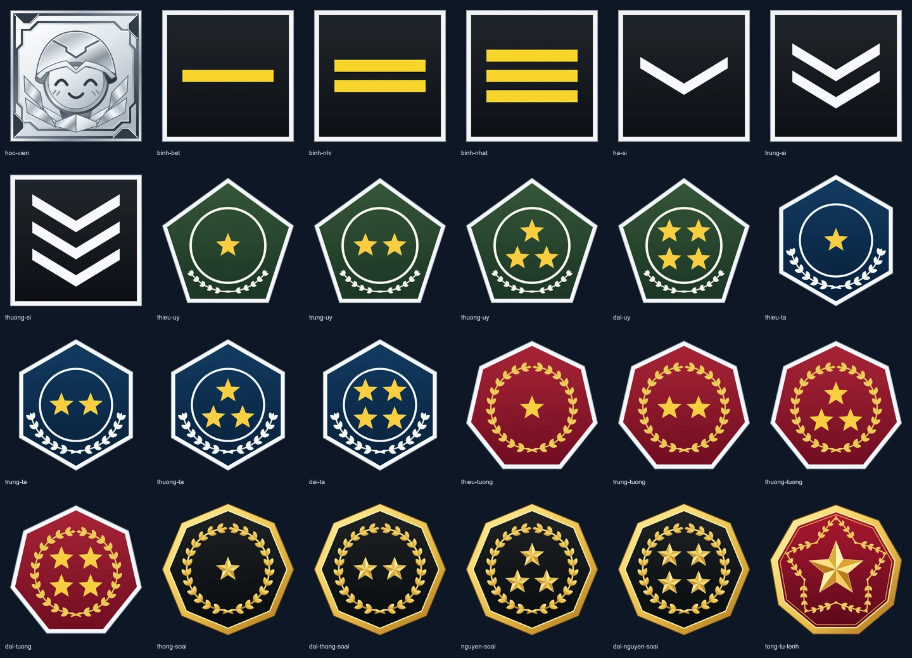

# Bộ huy hiệu vẽ lại sắc nét

Bộ asset gồm **24 PNG RGBA 896×896**, dựng bằng hình học vector. Ảnh tham chiếu chỉ dùng để quan sát thiết kế; renderer không đọc ảnh tham chiếu hay PNG cũ, không crop, trace pixel, upscale hoặc nhúng bitmap. Lần sửa chi tiết cấp Úy ngày 08/09/2026 không tham khảo thêm internet.



## Sửa chi tiết bốn huy hiệu cấp Úy

So với `6897ee5`, chỉ **Thiếu Úy, Trung Úy, Thượng Úy, Đại Úy** thay đổi artwork. Hai mươi PNG/SVG còn lại giữ nguyên nội dung; không đổi tên file, Badge ID, thứ tự cấp, màu nền, viền ngũ giác, số sao hay kiểu sao flat.

- **Cân bằng thị giác:** ngũ giác có phần thân dưới rộng hơn nên tâm bounding box không đủ làm chuẩn thị giác. `JUNIOR_OPTICAL_OFFSET_Y = 8` hạ vòng và cụm sao từ (112,112) xuống (112,120) trên canvas logic 224. Bán kính vòng giữ 59. Cặp nguyệt quế dùng cùng offset, tạo bố cục thấp hơn và liền khối. Đối chiếu cả bốn cấp cùng kích thước với cấp Tá; không bù riêng từng huy hiệu hoặc bằng CSS.
- **Vòng kín:** dùng một phần tử SVG circle nguyên vẹn, không dash, clip hay mask. Nét đều tăng từ 3,3 lên 3,8 đơn vị để rõ hơn khi thu nhỏ. Vòng được vẽ sau phần cành lá; sao giữ trong vòng. Kiểm tra trực tiếp chu vi raster của cả bốn PNG ở 896/224/96/50/24px.
- **Gốc chụm giữa:** hai thân cung tròn cùng xuất phát từ (112,193) sau offset, phản chiếu qua trục dọc. Mỗi gốc rộng 3,61 đơn vị rồi thuôn về thân 1,9; thân tỏa trái/phải và vòng lên, không còn hai cụm rời.
- **Mini laurel:** mỗi bên có năm cặp lá và một lá tận cùng, bước góc 10 độ, lá đầy hơn nhưng vẫn nhỏ hơn cấp Tá. Cung chỉ 55 độ so với 74 độ ở Tá, nên cặp cành thấp và gọn hơn. Lá gắn vào thân liên tục, chóp bo nhẹ; giữ khoảng trống với vòng trắng và cụm sao.
- **Hình học chung:** `juniorOfficerBase()` dựng cùng nền, cành và vòng cho cả bốn huy hiệu. Chỉ nhóm sao 1/2/3/4 thay đổi; hình sao, màu và bán kính 20 giữ nguyên, toàn cụm chỉ dịch xuống 8 đơn vị.

## Quy chuẩn các nhóm khác

- Học Viên: khung bạc và nhân vật đội mũ lính dựng bằng vector, gradient kim loại sạch.
- Binh Bét/Nhì/Nhất: 1/2/3 thanh vàng; Hạ/Trung/Thượng Sĩ: 1/2/3 chữ V trắng.
- Tá: vòng trắng tâm (112,112), bán kính 57; sáu cặp lá mỗi bên, thân 2,1 và cuống giao 2,4 đơn vị. Sao flat cùng bán kính 20 với Úy/Tướng.
- Tướng: vòng nguyệt quế tròn bán kính 65, 12 cặp lá mỗi bên, thân 2,1 và cuống giao 2,5; sao flat.
- Tứ Tinh Thủ Hộ: cùng vòng tròn bán kính 65 và 12 cặp lá mỗi bên; thân 2,5, cuống giao 2,9; lá vàng có gân và sao ceremonial bán kính 20.
- Tổng Tư Lệnh: năm nhánh quay đều từng 72 độ, hướng lá theo tiếp tuyến/pháp tuyến của thân, gốc thuôn 3,8 và thân 2 đơn vị. Sao ceremonial trung tâm bán kính 45, lớn nhất bộ; khung mười cạnh vàng.

## Asset và tích hợp

- PNG trong game: `public/assets/rank-badges/`; SVG master: `art/rank-badges/`.
- Canvas logic 224×224; xuất trực tiếp từ vector thành 896×896. Padding alpha tối thiểu 32px; không phóng PNG nhỏ.
- Tổng dung lượng 24 PNG hiện tại: **2.009.676 byte**. SVG và ảnh tổng quan nằm ngoài public.
- `src/game/rankBadgeAssets.ts` giữ đủ 24 ID, đường dẫn file và outer ratio; lần này chỉ đổi hash nội dung của bốn URL cấp Úy để nhận ảnh mới.
- Alpha của toàn bộ PNG giống bản trước. RankBadge, RankTierProgress, HomeXpJourney, modal, danh sách, hồ sơ và các caller tiếp tục dùng nguyên layout, kích thước và component chung.
- Không sửa XP, catalog/families, tierCount, save/migration, phần thưởng hoặc tương tác game.

## Xuất lại và kiểm tra

Nguồn chuẩn: `scripts/assets/render_rank_badges.cjs`. Dùng Node.js và Sharp **0.35.4**, librsvg 2.62.91; Sharp là công cụ authoring, không phải dependency runtime của game. Trỏ NODE_PATH đến bộ công cụ có Sharp:

```sh
NODE_PATH=/path/to/node_modules node scripts/assets/render_rank_badges.cjs
NODE_PATH=/path/to/node_modules node scripts/assets/audit_rank_badges.cjs 6897ee5 junior
```

Renderer xuất SVG, PNG, registry và ảnh tổng quan. Audit chế độ junior xác nhận đúng bốn PNG thay đổi, 20 PNG còn lại giữ nguyên từng byte, alpha/outer ratio/mapping giữ nguyên, hash khớp file, sao giữ nguyên artwork, bốn base giống nhau, gốc giữa và vòng trắng kín qua lấy mẫu chu vi raster. Khi so sánh lần polish trước trên đúng checkout 6897ee5, dùng audit với baseline 594da9d và bỏ đối số junior.

Đã xem bộ bốn cấp Úy cạnh cấp Tá ở cùng kích thước, kiểm tra thêm 96/50/24px trên nền sáng/tối. `npm run lint`, `npm run build` và `git diff --check` đạt; build còn cảnh báo bundle lớn hơn 500 kB. Chưa chạy game hoặc QA giao diện bằng trình duyệt; đây là kiểm tra asset và kiểm tra tĩnh, không thay cho xác nhận runtime.
